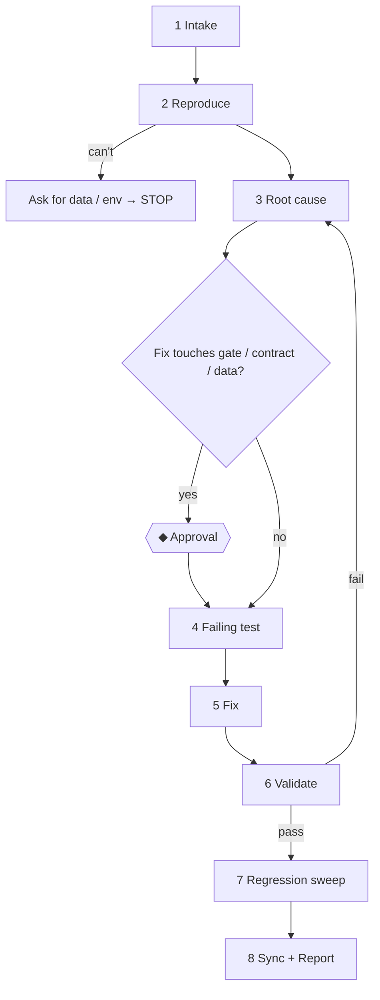

# Bugfix Workflow

> **Load when:** behaviour differs from what it should be (`/bugfix`).

| # | Node | Exit check |
| --- | --- | --- |
| 1 | Intake | Expected vs actual, severity, environment; class S/M/L |
| 2 | Reproduce | Reliable repro recorded (command/test/steps). Code vs requirement mismatch? → confirm which is right (`02-context-engineering/source-of-truth.md`) |
| 3 | Root cause | `03-loop-engineering/debugging-loop.md`; cause stated with evidence, not "probably" |
| ◆ | Approval | Only if the fix hits a gate |
| 4 | Failing test | A test that fails for the bug's reason (skip only if the layer is untestable — say so) |
| 5 | Fix | Smallest change at the root cause; no refactor riding along (CODE-6) |
| 6 | Validate | Test passes; gates pass |
| 7 | Regression sweep | Search for the same pattern elsewhere; list other instances (fix only if in scope) |
| 8 | Sync + Report | Trap recorded in the feature's `testing.md` §Known issues if non-obvious; changelog `Fixed`; report includes root cause in one sentence |

## Hotfix (production down)

Same graph, compressed: reproduce → minimal fix → gates → ◆ approval to ship. The follow-up task
(root-cause hardening, tests, docs) is written into `STATE.md` before the hotfix is reported done.
