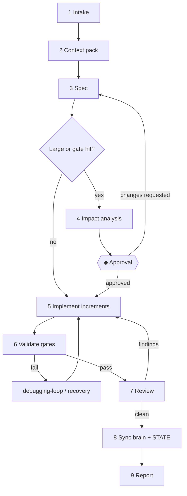

# Feature Workflow

> **Load when:** adding or changing user-visible behaviour (`/feature`).

| # | Node | Output / exit check |
| --- | --- | --- |
| 1 | Intake | Goal restated; class S/M/L; missing info → questions with defaults (`01-prompt-engineering/principles.md`) |
| 2 | Context pack | ≤ 15 lines: feature folder, BR-###, reference implementation, files, contracts (`02-context-engineering/context-retrieval.md`) |
| 3 | Spec | `01-prompt-engineering/task-specifications.md` template; every criterion checkable. Large/new feature → saved in `features/<slug>/requirements.md` |
| 4 | Impact | `09-knowledge-maintenance/change-impact-analysis.md` filled |
| ◆ | Approval | Explicit yes for this scope (`approval-workflow.md`) |
| 5 | Implement | `03-loop-engineering/development-loop.md`; green after each increment |
| 6 | Validate | All gates (`04-harness-engineering/enforcement/quality-enforcement.md` §1); a test per acceptance criterion |
| 7 | Review | `03-loop-engineering/review-loop.md`; Large → `reviewer` subagent |
| 8 | Sync | Feature folder + registry status, affected 06 files, `STATE.md`, changelog (`09-knowledge-maintenance/synchronization-policy.md`) |
| 9 | Report | `01-prompt-engineering/output-contracts.md` §Final report |

## New-feature specifics

- Create `07-feature-documentation/features/<slug>/` by copying `example-feature/`; register it as
  `F-###` with status `planned` at node 3, `in-progress` at 5, `done` at 8.
- Small features may keep only `overview.md` + `testing.md` (`feature-template.md`).
