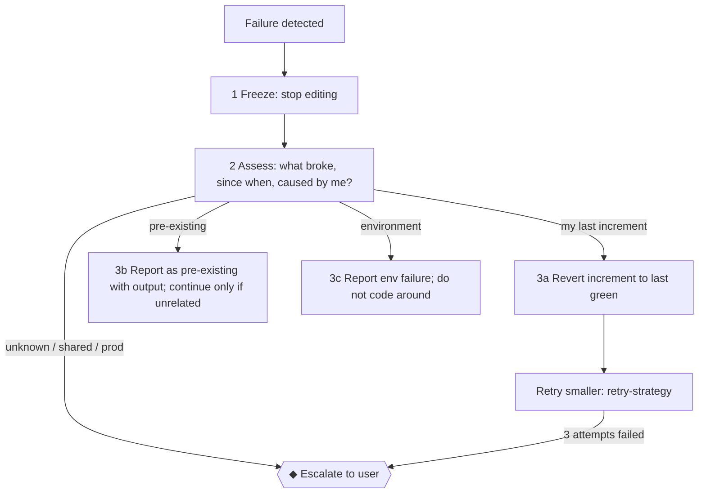

# Recovery Workflow

> **Load when:** a gate fails after your change, the working tree is in a bad state, or something
> broke beyond the task. **Rules:** ENF-2, ENF-3, TOOL-3.

## 1. Failure playbook

| Failure | First move |
| --- | --- |
| Typecheck errors after my change | Read the first error; fix in my diff only. Errors in untouched files → was it already red? (`git stash` → re-run → `git stash pop`) |
| Lint errors | Fix code; never disable the rule (ENF-2) |
| Test failures | Mine → debugging loop. Unrelated + was red before → report pre-existing |
| Build fails | Read the full output; env (missing var, network) → report (TOOL-6) |
| Broken dependency install | Report; propose a clean reinstall with the project's manager (Ask tier) |
| Merge conflict | Resolve preserving both intents; ambiguous → ask. Never `--theirs`/`--ours` blindly |
| Lost/overwritten work | Stop. `git reflog`, `git stash list`, editor history — recover before anything else |
| Partial edit across many files | Revert to last green (`git diff` → `git checkout -- <files I changed>`, Ask tier for anything broad) |

## 2. Rules

- **Revert before you debug forward** when the last increment broke things and the cause isn't obvious.
- Only revert **your own** changes. Never discard changes you didn't make.
- Establish whether the failure is pre-existing **before** fixing it: compare against the base commit.
- Every recovery is reported: what failed, what was done, current state, and what remains.
- After recovery, record any non-obvious trap in `STATE.md` §Session handoff.
