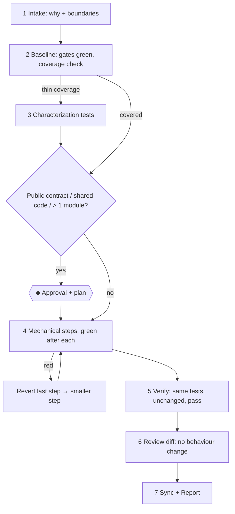

# Refactoring Workflow

> **Load when:** restructuring without behaviour change (`/refactor`). Rules: `04-harness-engineering/coding/refactoring-rules.md`.

| # | Node | Exit check |
| --- | --- | --- |
| 1 | Intake | The problem with the current shape; modules in scope; explicit "no behaviour change" |
| 2 | Baseline | All gates pass **before** touching code. Red baseline → report; don't refactor on red |
| 3 | Characterization | Tests pin current behaviour (including quirks) |
| ◆ | Approval | Contract or shared-code changes; plan uses expand → migrate → contract |
| 4 | Steps | One mechanical step at a time; red → revert, not debug forward |
| 5 | Verify | Same tests, unmodified, pass; build artifacts/outputs equivalent where checkable |
| 6 | Review | Diff contains no behaviour change; any found → split it out |
| 7 | Sync | `system-architecture.md` / `module-boundaries.md` / `code-patterns.md` if structure changed |
