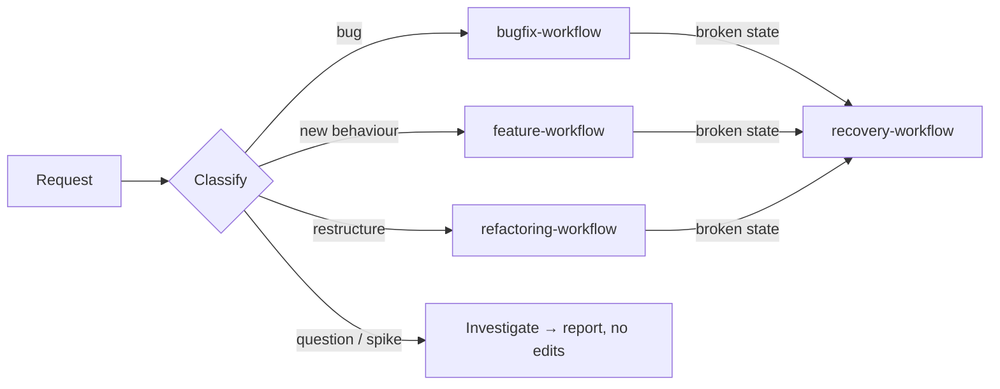

# Workflow Design

> **Load when:** starting any task (classify + route), or the brain is uninitialized (§Bootstrap).

## 1. Graph principles

- A workflow is a graph of **nodes** (steps with one output) and **edges** (conditions).
- Every node has an **exit check**; you can't leave a node until it passes.
- **Gates** (◆) are nodes only a human can pass (`approval-workflow.md`).
- Every failure edge leads somewhere defined: a loop (`03-loop-engineering/`), `recovery-workflow.md`,
  or STOP (`03-loop-engineering/stopping-conditions.md`). No dead ends, no silent exits.
- Loops are bounded (`retry-strategy.md`).
- Nodes are skipped only by class (below), never by convenience.

## 2. Classify → route

| Class | Signals (any) | Path |
| --- | --- | --- |
| **Small** | 1–2 files, localized, existing pattern, no contract/data/security impact | Inspect → Implement → Validate → Report |
| **Medium** | Several files or real behaviour change; no gate hit; one module | Inspect → Context pack → Plan → Implement → Validate → Review → Sync → Report |
| **Large** | Cross-module; public contract, data/migration, auth/security, payments, SEO, infra, or production impact; any approval gate | Discover → Spec → Impact → ◆Approval → Implement (increments) → Validate → Independent review → Sync → Report |

When in doubt, classify up. Re-classify the moment new facts appear.

## 3. Splitting

Split into separate, individually verified units when any is true: > ~5 files; > 1 module;
refactor + behaviour change; new page/endpoint + navigation/wiring; data migration + code using it;
shared primitive change. State the split as a numbered plan; execute in order; each unit goes
through its own workflow.

## 4. Bootstrap (`/brain-init`)

Run once per project, or when `brain-check.sh` reports unfilled slots.

0. **Location** — run in the main working-tree root (parent of `git rev-parse --path-format=absolute
   --git-common-dir`). Inside a linked worktree (`--show-toplevel` differs) → stop and name the root.
1. **Scan** (delegate to `context-scout`): manifests, lockfile, configs, folder tree (2 levels),
   README, CI, entry points, test setup, env example, git log summary. Never read secrets.
2. **Fill verifiable slots** — replace each double-brace slot with facts from the scan. Priority:
   `AGENTS.md` snapshot → `project-context.md` → `module-boundaries.md`, `dependency-rules.md`,
   `architectural-patterns.md`, `code-patterns.md` → `06-project-knowledge/*` → `10-project-standards/*`.
3. **Mark the rest** — unverifiable slot → `**Open question:** …` (and copy it to `STATE.md`), or
   `Not applicable — <reason>`. Never invent. A missing gate (e.g. no lint script) → `none`.
4. **Register features** found in the code in `07-feature-documentation/feature-registry.md`
   (status `existing — undocumented`); document none yet unless asked.
5. **Tune the harness** — protected paths, Ask-tier commands, gate commands; propose
   `.claude/settings.json` additions (approval: protected path).
6. **Verify** — `bash .claude/hooks/brain-check.sh` → 0 unfilled slots outside templates.
7. **Report** — what was filled, open questions as one batch (output-contracts §Questions), and the
   files changed. Set `STATE.md` phase and goal from the answers.
