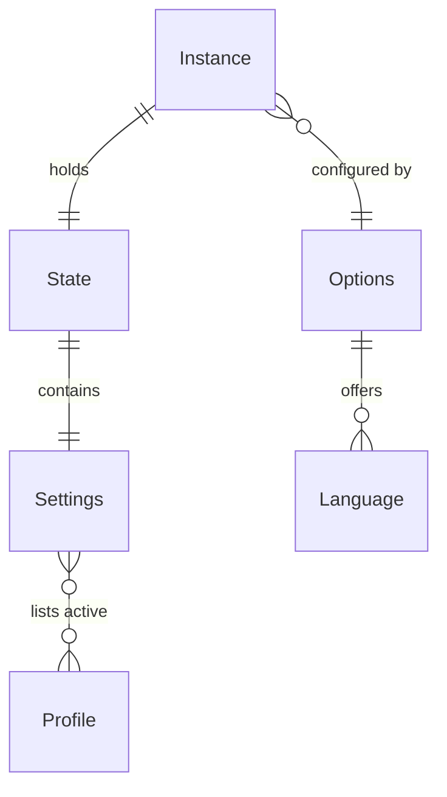
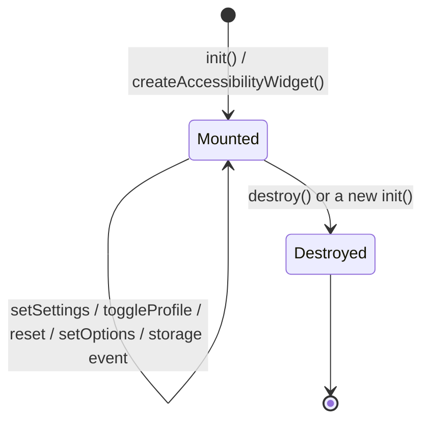

# Domain Model

> **Load when:** working with settings, profiles, options, languages, or the widget instance.
> **Last verified:** 2026-10-11

## 1. Entities

| Entity | Meaning | Key fields | Owned by (module) | Stored in |
| --- | --- | --- | --- | --- |
| Settings (`AccessibilitySettings`) | The visitor's adjustments | `profiles`, `fontSize`, `contentScale`, `lineHeight`, `letterSpacing`, `textAlign`, `colorMode`, `saturationMode`, colors, booleans, `cursor` | `src/settings.ts` (schema), `src/widget.ts` (state) | `localStorage` (`a11yw-settings`) |
| Profile (`ProfileId`, `ProfilePreset`) | Shortcut that switches on several settings | id, preset settings | `src/settings.ts` (`PROFILE_IDS`, `PROFILE_PRESETS`) | Ids inside Settings |
| Options (`AccessibilityWidgetOptions`) | Site owner's configuration | `position`, `theme`, `icon`, `logo`, `languages`, `labels`, `features`, `initialSettings`, `storageKey`, `persist`, `nonce`, `zIndex`, `statementUrl`, `onChange` | `src/types.ts` | Not stored |
| Language (`AccessibilityLanguage`) | A set of UI labels with direction | `code`, `name`, `labels`, `dir?` | `src/labels.ts` | Chosen code at `<storageKey>:lang` |
| Instance (`AccessibilityWidgetInstance`) | The mounted widget and its API | `open/close/toggle`, `get/setSettings`, `toggleProfile`, `reset`, `setOptions`, `subscribe`, `destroy` | `src/widget.ts` | Registry on `globalThis` |
| State (`AccessibilityState`) | Snapshot given to listeners | `settings`, `isOpen` | `src/widget.ts` | Memory (frozen) |

## 2. Relationships

## 3. Lifecycles

Profile on/off: BR-009. Replacement by a second instance: BR-010.

## 4. Field traps

| Entity.field | Trap |
| --- | --- |
| Profile ids | Ids are kept for compatibility, visible names differ: `seizureSafe` = Motion sensitivity, `screenReader` = Quiet media, `cognitiveDisability` = Easy reading, `olderAdults` = Comfortable reading, `adhdFriendly` = Focus mode, `visionImpaired` = Low vision, `keyboardNav` = Keyboard user |
| Range settings (`fontSize`, …) | Percentages, 100 = off; clamped and rounded to `RANGES` |
| `lineHeight` | Applied as absolute `1.5 × percent` line height |
| `textColor` / `titleColor` / `backgroundColor` | Hex only (`HEX_COLOR`), lower-cased, `null` = off |
| Stored JSON `v` | `STORAGE_VERSION` (1); unversioned 1.0.x data has the same shape; any other version → defaults |
| `contentScale` ("Page zoom") | CSS `zoom` — doesn't trigger media queries |

Term definitions: `glossary.md`.
