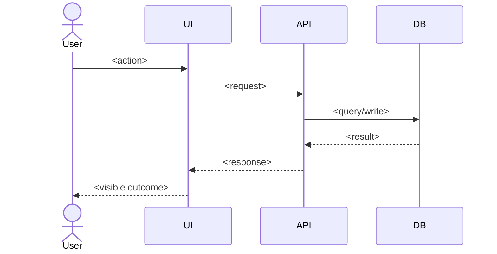

# <Feature name> — Workflows

## Main flow

## States

<!-- If the feature has a lifecycle (draft → submitted → approved). Transitions reference BR-###. -->

| From | Event | To | Rule |
| --- | --- | --- | --- |
| <state> | <event> | <state> | <BR-###> |

## Edge cases

| Case | Expected behaviour |
| --- | --- |
| <empty / duplicate / concurrent / expired / offline / limit> | <behaviour> |

## Failure paths

| Failure | User sees | System does |
| --- | --- | --- |
| <dependency down / validation / forbidden> | <message/state> | <log, retry, rollback> |
